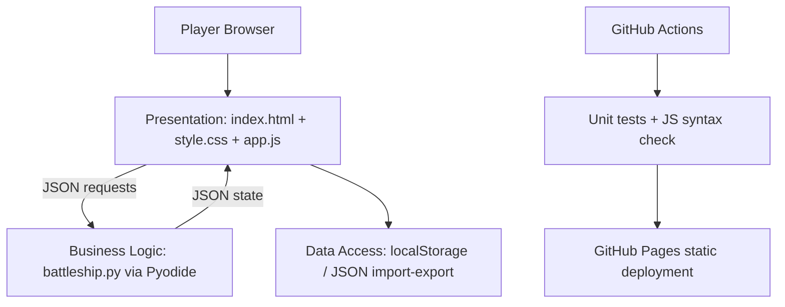
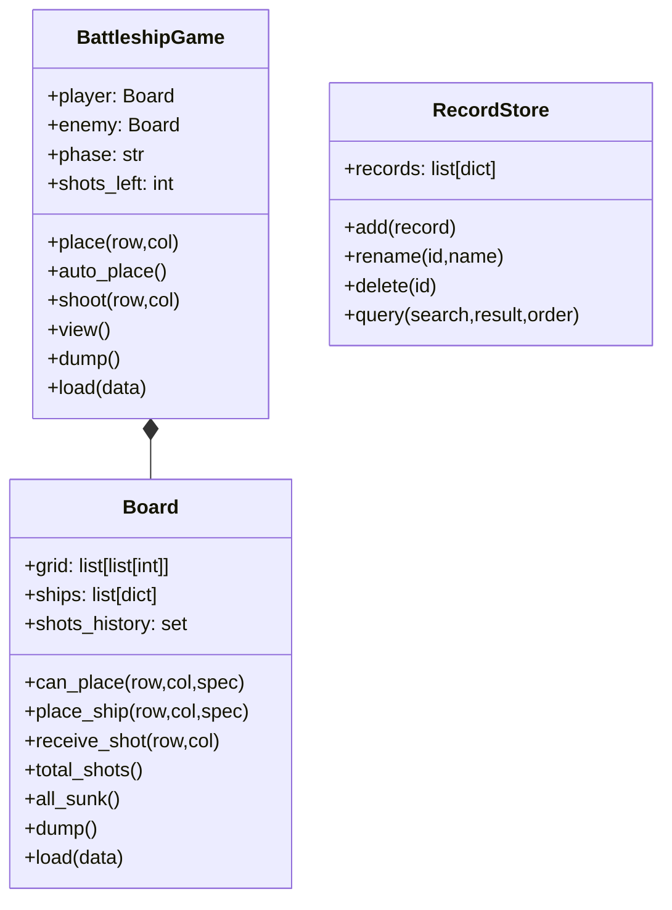

# PLAN — Battleship: Multi-Shot Edition (Web Final Project)

**รายวิชา:** CP352301 Script Programming • **เป้าหมาย:** พัฒนา mini-project Python CLI เป็นเกมเล่นผ่าน GitHub Pages ได้ • **สถานะ:** Implementation / local automated tests complete; ยังไม่ได้เผยแพร่จริงบนบัญชี GitHub

## 1. Problem statement / Objectives

เดิมเกม Battleship ต้องติดตั้ง Python และรับพิกัดผ่าน terminal จึงใช้งานยากบนมือถือและแชร์ให้คนอื่นเล่นได้ไม่สะดวก โปรเจกต์นี้แปลงเป็นเว็บเกมที่รัน **Python Game Engine จริงในเบราว์เซอร์ด้วย Pyodide** โดยไม่มี backend server และ deploy เป็นเว็บไซต์ static บน GitHub Pages ได้

### Functional requirements

| ID | ความต้องการ | Acceptance criteria |
|---|---|---|
| FR-01 | กระดาน 10×10 สองฝ่าย | เรือศัตรูที่ยังไม่โดนต้องถูกซ่อน |
| FR-02 | กองเรือ 6 ลำ เหมือน mini project | เรือ 1×1 สองลำ, 1×3, 3×1, 1×5, 5×1 |
| FR-03 | วางเรือเอง/สุ่ม | วางเกินขอบหรือทับกันไม่ได้; สุ่มแล้วครบ 6 ลำ |
| FR-04 | ยิงหลายครั้ง/เทิร์น | เริ่มที่ 10 นัด และลดเมื่อเรือเจ้าของถูกจม |
| FR-05 | Computer AI | สุ่มยิงจากช่องที่ยังไม่เคยยิงโดยไม่มีซ้ำ |
| FR-06 | ผลการแข่งขัน | เมื่อเรือทุกลำฝ่ายใดจมให้หยุดเกมและระบุผู้ชนะ |
| FR-07 | Data persistence | รีเฟรชแล้วโหลดสถานะผ่าน localStorage; backup นำเข้า/ส่งออก JSON ได้ |
| FR-08 | Record CRUD | บันทึกผลเมื่อจบเกม, แสดง, แก้ชื่อ, ลบ พร้อมค้นหา กรอง เรียงลำดับ |
| FR-09 | Defensive programming | ป้องกันพิกัดนอกกระดาน ยิงซ้ำ ข้อมูลสำรองผิด schema |
| FR-10 | CI/CD | GitHub Actions compile/test/check JS ก่อน upload/deploy Pages |

**Non-functional:** ใช้งานได้ทั้งจอใหญ่และจอเล็ก, แสดงข้อความเป็นภาษาไทย, ไม่ต้องมีคีย์ API/ฐานข้อมูลภายนอก, หลักการ OOP/Modular Architecture, browser โหลด Pyodide ผ่าน CDN ครั้งแรก

## 2. System architecture

**Layer 1 — Presentation:** HTML/CSS/JavaScript รับเหตุการณ์คลิก แสดงสถานะและข้อความ ไม่ตัดสินผลยิงเอง  
**Layer 2 — Business:** `Board`, `BattleshipGame`, `RecordStore`, `GameError`; เมธอดและ `api(request_json)` เป็นสัญญาเชื่อมต่อ  
**Layer 3 — Data Access:** `app.js` เก็บ JSON ลง `localStorage`, ส่งออกหรือนำเข้าข้อมูลจากไฟล์ผ่าน File API; Python validate และ serialize domain object. ไม่ใช่ server-side File I/O เพราะ GitHub Pages ไม่รัน Python ฝั่งเซิร์ฟเวอร์

## 3. Data schema

`game` object: `version`, `player`, `enemy`, `phase` (`setup`, `battle`, `finished`), `turn`, `shots_left`, `winner`. `Board` object: `grid` (10×10; 0 water,1 ship,2 miss,3 hit,4 sunk), `ships` (name, coords, shots, hits), `shots_history`. ข้อมูล history ตรวจย้อนหลังโดยสร้างกระดานใหม่จากรูปทรงเรือและพิกัดการยิงก่อนยอมรับ backup

`record` object: `{ "id":"UUID", "name":"Captain", "turns":5, "result":"win", "date":"2026-10-24T...Z" }`; 500 รายการสูงสุดต่อการนำเข้า ใช้ `RecordStore.query` สำหรับ search (case insensitive), filter (`win/lose`), sort (`newest/oldest/turns`).

**Browser storage:** `battleship_final_game_v1` และ `battleship_final_records_v1`. ข้อมูลอยู่เฉพาะ origin/browser นั้น ไม่ซิงก์ข้ามอุปกรณ์และล้างเมื่อผู้ใช้ล้างข้อมูลไซต์; ส่งออก JSON เพื่อเก็บสำรองได้

## 4. Sprint schedule / roles

| Sprint | หัวข้อ | Deliverable | วันนำเสนอ / วันส่ง (จากโจทย์) |
|---|---|---|---|
| 1 | Front-End | UI, validation, HTML/CSS | 15–16 ก.ย. / 18 ก.ย. 2569 |
| 2 | Back-End | Python OOP + persistence + CRUD/algorithms | 22–23 ก.ย. / 25 ก.ย. 2569 |
| 3 | Integration | JS-Python bridge, state consistency, error resilience | 29–30 ก.ย. / 2 ต.ค. 2569 |
| Final | DevOps & AI | tests, CI/CD, documentation, AI-assisted smart AI plan | 6–7 ต.ค. / 16 ต.ค. 2569 |

**บทบาท:** โครงงานที่ได้รับมามีผู้จัดทำรายเดียว; ในทุก Sprint ผู้จัดทำสวมบท Planner → Coder → Debugger ตามกระบวนการที่รายวิชากำหนด ไม่สมมติสมาชิก/PR ที่ไม่ได้มีหลักฐาน

## 5. Definition of Done

- [x] แยก Presentation/Business/Data Access อย่างชัดเจน
- [x] กติกา Python ใช้ทดสอบด้วย CPython ได้ และโหลดจากเว็บด้วย Pyodide
- [x] มีการตรวจสอบข้อมูลนำเข้า, JSON schema บางส่วน, API จัดการ error
- [x] มี UI 2 กระดาน, ออโต้วางเรือ, เกมยิง, บันทึกและจัดการประวัติ
- [x] เตรียม GitHub Actions พร้อม unit tests และขั้น deploy
- [ ] เปิด repository ของผู้ใช้, push และตรวจผล CI ใน GitHub
- [ ] ตรวจผ่านเบราว์เซอร์จริงบน URL ของ GitHub Pages และบนมือถือ

## 6. Risk / tradeoffs / AI integration

| Risk | แนวทาง |
|---|---|
| GitHub Pages ไม่สามารถรัน Python server-side | ใช้ Pyodide โหลด Python ใน browser; ไม่ใช้ Flask server |
| โหลด Python runtime ช้า/ออฟไลน์ | แสดง loading state; ต้องใช้อินเทอร์เน็ตในการโหลด CDN |
| โกงข้อมูลคะแนนด้วย localStorage | คะแนนใช้เพื่อสาธิต ไม่ถือเป็น authoritative leaderboard; ถ้าต้องการคะแนนแข่งขันใช้ server/database |
| Backup ผิดรูปแบบ | validate JSON และไม่ปล่อย Python exception เข้าหน้าเว็บ |
| Random AI ยิงซ้ำ | เลือกจากเซตของช่องที่ยังไม่เคยยิง |

**AI/Automation Integration ที่มีจริง:** computer opponent แบบ automated random targeting และ GitHub Actions automated testing/deployment. **AI-assisted development:** เรียนรู้จาก prompt/reflection เดิมใน `legacy/LEARNINGLOG.md`; ไม่อ้างว่าเป็น LLM-powered AI. **Roadmap:** heuristic hunt/target AI (เลือกช่องใกล้ตำแหน่งโดนก่อน) หรือ external LLM API หลังเพิ่ม server-proxy แยกต่างหากเพื่อปกป้อง API key

## 7. Live demo (5-part presentation)

1. **Problem & Architecture (20%):** CLI → website; อธิบาย UML และ 3 layers
2. **Stack (10%):** Python 3.12 tests, Pyodide 0.27.7, HTML/CSS/JS, localStorage, GitHub Actions
3. **Live Demo (40%):** เริ่มใหม่ → วางเรือ/สุ่ม → ยิงจนจบเกม → รีเฟรช/โหลด → แสดงประวัติ → แก้ไข/ลบ → search/filter/sort → ส่งออก/นำเข้า JSON → ใส่ไฟล์ JSON เสีย
4. **Technical comparisons (15%):** CLI input/print vs button/grid; session memory vs persistent JSON; JS rules vs Python via WebAssembly
5. **DevOps & Automation (15%):** แสดง green test run และ workflow deploy บน GitHub ของจริง; อธิบาย random AI และแผน smart targeting

## 8. Next actions before submission

1. Push source ที่ root ของ repository (รวม `.github/workflows/pages.yml`).
2. Repository → Settings → Pages → Source: **GitHub Actions**.
3. รอ Actions ทำงานสำเร็จและเปิด URL `https://methus-bit.github.io/script-programming-final-project/`.
4. บันทึกหลักฐาน screenshot/URL/PR เฉพาะของจริง แล้วใส่ในรายงาน Sprint และสไลด์.
